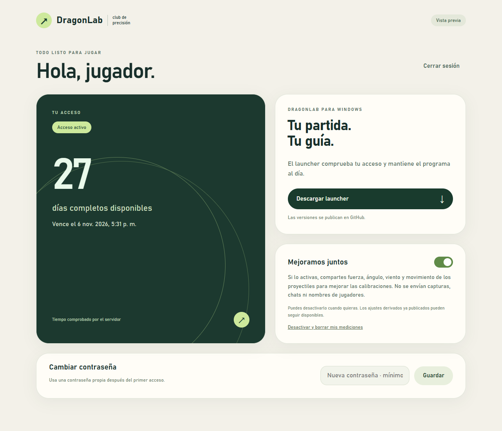

# DragonLab Cloud

Login y distribución para Windows, con panel de cuentas y administración de acceso por meses.

Frontend: React + TypeScript + Vite. Backend: funciones de Supabase con Deno y TypeScript. Datos y permisos: PostgreSQL. Frontend y backend se despliegan por separado; el cálculo durante la partida permanece en la PC.

- El administrador crea usuarios, añade 1–24 meses y suspende accesos. El usuario ve cuánto tiempo queda y puede cambiar su contraseña.
- Las fechas se comprueban en el servidor. El cliente Cloud comprueba el acceso antes de iniciar y durante la sesión.
- El launcher usa GitHub Releases y verifica SHA-256 antes de instalar una actualización.
- Los usuarios pueden compartir nuevas mediciones de tiros con consentimiento. Se generan propuestas de calibración y el administrador decide publicarlas.
- Las capturas de pantalla no se envían al servidor.

**Estado:** implementación preparada y probada localmente. Supabase y Cloudflare todavía no están configurados para producción; no hay una Release Cloud publicada. Las vistas de ejemplo están marcadas como vista previa.

Sigue [la guía de activación](cloud/GUIA-ACTIVACION.md) para crear las cuentas gratuitas, preparar tu administrador y publicar el panel y el launcher.

Vista de cuenta:



## Desarrollo y comprobaciones

```text
cd cloud
npm install
npm run test:db
cd ..
python -m unittest discover -s cloud/tests -p "test_*.py"
npm ci --prefix cloud/frontend
npm run dev --prefix cloud/frontend
```

Abre `http://127.0.0.1:8767/?preview=user` o `?preview=admin` para revisar las vistas. Las acciones de esa vista previa no crean cuentas ni cambian datos. Para usar el panel real, genera `config.json` con `cloud/write_config.mjs` y las variables públicas descritas en la guía.

La compilación del panel se comprueba con `npm run build --prefix cloud/frontend`. Las pruebas de la API se ejecutan con `deno test cloud/tests/api_test.ts`.

Los tests SQL ejecutan PostgreSQL mediante PGlite y comprueban permisos, acceso por cuenta, caducidad, renovaciones idempotentes, suspensión, consentimiento, deduplicación y borrado. Los tests Python comprueban descargas dañadas, aislamiento de datos enviados, compatibilidad de perfiles y validación entre participantes. Las mediciones usadas en esos tests son fixtures; nunca se importan a las calibraciones reales.

La primera propuesta automática cubre lanzamientos sin viento. El servidor no convierte datos de ese alcance en una garantía de climas, contactos o comportamientos especiales. La calibración real de los carros continúa como tarea independiente.
